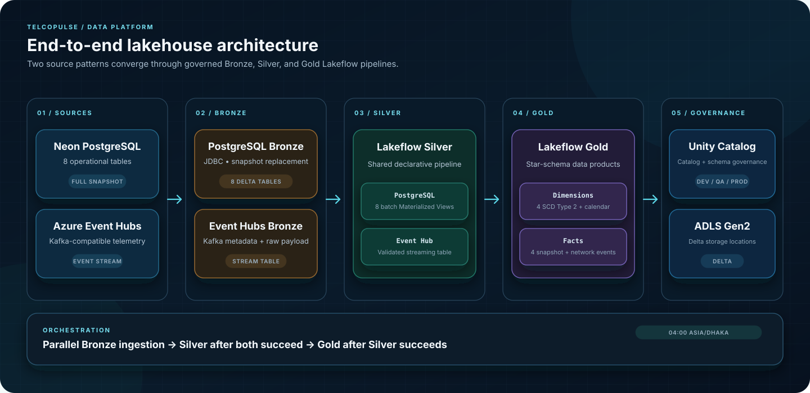
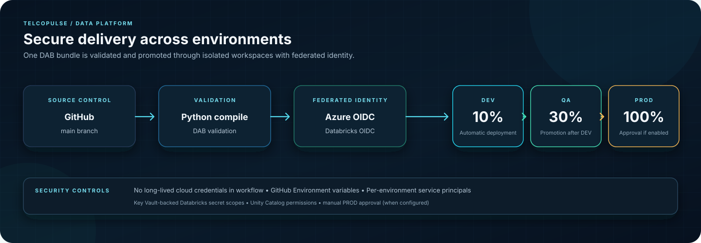
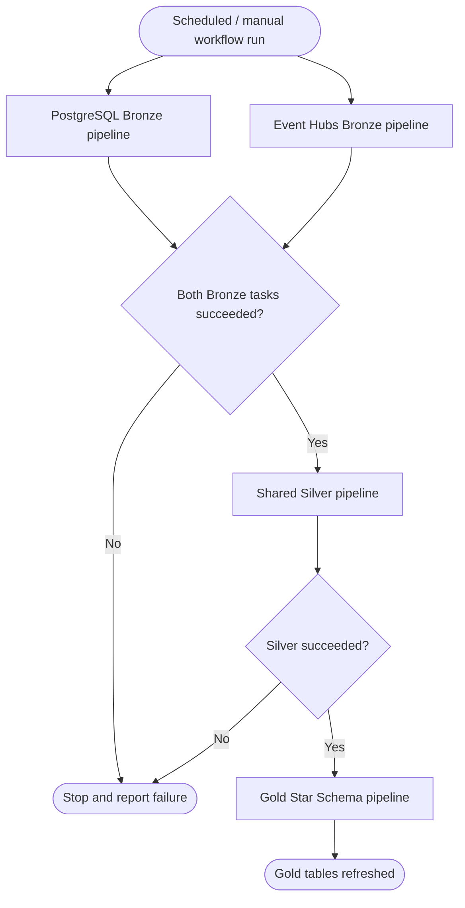
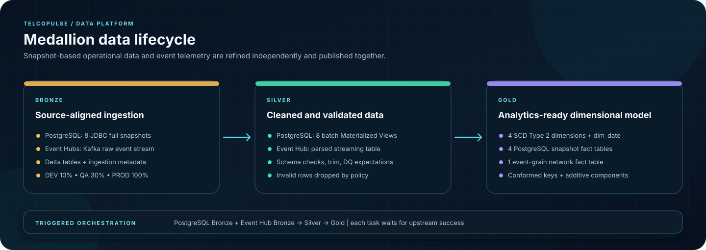
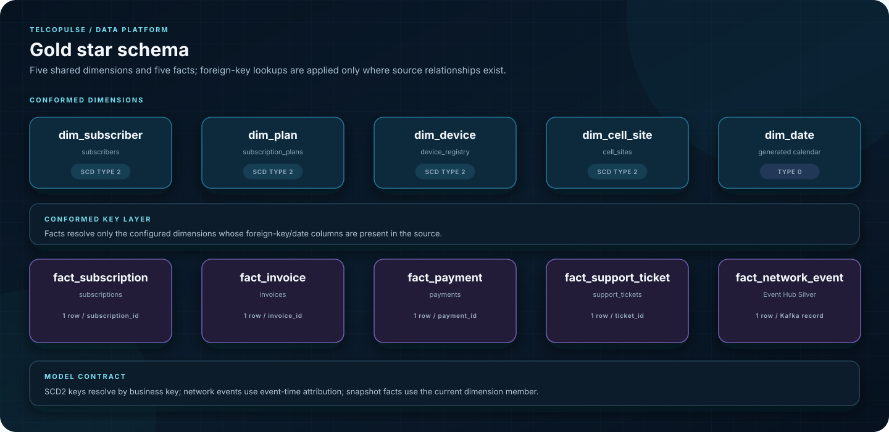
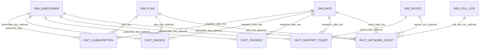
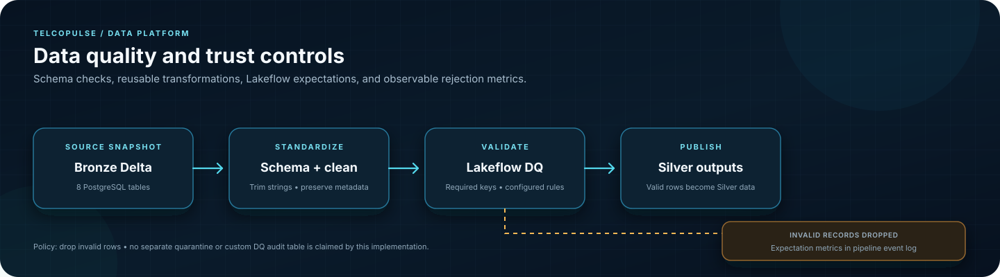

<div align="center">

# TelcoPulse Lakehouse

### A Batch + Streaming Telecom Data Platform on Microsoft Azure

**From operational PostgreSQL data and network telemetry to governed analytics-ready data products.**

<p>
  <a href="https://github.com/hridoy1335/telcopulse-lakehouse"></a>
  
  
  
  
  
  <a href="LICENSE"></a>
</p>

<p>
  <a href="#-architecture-at-a-glance">Architecture</a> •
  <a href="#-medallion-data-platform">Medallion</a> •
  <a href="#-gold-star-schema">Star Schema</a> •
  <a href="#-deployment-and-cicd">CI/CD</a> •
  <a href="#-run-and-deploy">Run & Deploy</a>
</p>

</div>

<p align="center">
  
</p>

<p align="center">
  <sub>Operational data + network telemetry → governed Delta Lakehouse → analytics-ready data products</sub>
</p>

---

## Overview

**TelcoPulse Lakehouse** is an end-to-end data engineering platform that brings together two different telecom data workloads:

- **Operational / relational data** from Neon PostgreSQL, ingested as full snapshots.
- **Network telemetry events** from Azure Event Hubs, consumed through its Kafka-compatible endpoint.

The platform processes both workloads with **Azure Databricks, Apache Spark, PySpark, Spark SQL, Delta Lake, and Lakeflow Spark Declarative Pipelines**. Data moves through Bronze, Silver, and Gold layers, while Unity Catalog provides the data governance boundary. Databricks Asset Bundles (DAB) and GitHub Actions automate deployment across isolated DEV, QA, and PROD environments using OpenID Connect (OIDC) federation.

The project demonstrates the engineering work behind a modern lakehouse: source ingestion, batch and streaming processing, data quality, snapshot-aware history, dimensional modeling, environment configuration, identity, and deployment orchestration.

> **Project repository:** [github.com/hridoy1335/telcopulse-lakehouse](https://github.com/hridoy1335/telcopulse-lakehouse)

## Project at a glance

| Area | Implementation |
|---|---|
| Business domain | Telecom operations and network usage analytics |
| Relational source | Neon PostgreSQL — 8 operational tables |
| Event source | Azure Event Hubs using the Kafka protocol |
| Cloud platform | Microsoft Azure |
| Processing | Azure Databricks, Apache Spark, PySpark, Spark SQL |
| Pipeline framework | Lakeflow Spark Declarative Pipelines |
| Storage / table format | Azure Data Lake Storage Gen2 and Delta Lake |
| Data architecture | Medallion architecture: Bronze → Silver → Gold |
| Modeling | Star schema, conformed dimensions, SCD Type 2, fact tables |
| Governance | Unity Catalog |
| Deployment | Databricks Asset Bundles |
| CI/CD and identity | GitHub Actions, Microsoft Entra ID OIDC, Databricks OIDC federation |
| Environments | Isolated DEV, QA, and PROD targets |
| Orchestration | Databricks Workflows job with dependent pipeline tasks |

## Table of contents

- [Architecture at a glance](#-architecture-at-a-glance)
- [Technology stack](#-technology-stack)
- [Data sources](#-data-sources)
- [Medallion data platform](#-medallion-data-platform)
- [Gold star schema](#-gold-star-schema)
- [Data quality and reliability](#-data-quality-and-reliability)
- [Delta Lake and Spark engineering](#-delta-lake-and-spark-engineering)
- [Environment strategy](#-environment-strategy)
- [Deployment and CI/CD](#-deployment-and-cicd)
- [Security and governance](#-security-and-governance)
- [Repository structure](#-repository-structure)
- [Run and deploy](#-run-and-deploy)
- [Operational flow and monitoring](#-operational-flow-and-monitoring)
- [Analytics examples](#-analytics-examples)
- [Engineering decisions and limitations](#-engineering-decisions-and-limitations)
- [Skills demonstrated](#-skills-demonstrated)
- [License](#-license)

---

## 🏗️ Architecture at a glance

The architecture separates ingestion, refinement, and analytical modeling into independent Lakeflow pipelines. PostgreSQL and Event Hubs are ingested independently, Silver starts after both Bronze tasks succeed, and Gold starts only after Silver completes.

<p align="center">
  
</p>

<details>
<summary>View the Mermaid source diagram</summary>



</details>

```mermaid
flowchart LR
    subgraph SOURCES[Data Sources]
        PG[(Neon PostgreSQL\n8 operational tables)]
        EH[(Azure Event Hubs\nKafka-compatible events)]
    end

    subgraph BRONZE[Bronze - Raw Ingestion]
        PGB[PostgreSQL Bronze\nJDBC full snapshots]
        EHB[Event Hubs Bronze\nKafka stream ingestion]
        PGT[(8 Bronze Delta tables)]
        EHT[(Raw event Delta table)]
        PGB --> PGT
        EHB --> EHT
    end

    subgraph SILVER[Silver - Clean and Conform]
        SP[Shared Silver Lakeflow pipeline]
        PGS[(8 PostgreSQL Silver\nMaterialized Views)]
        EHS[(Event Hub Silver\nStreaming Table)]
        SP --> PGS
        SP --> EHS
    end

    subgraph GOLD[Gold - Business Model]
        GP[Gold Lakeflow pipeline]
        DIMS[(Dimensions\nSCD Type 2 + Date)]
        FACTS[(Fact tables\nOperational + Network)]
        GP --> DIMS
        GP --> FACTS
    end

    UC[Unity Catalog\nEnvironment-specific catalogs]
    ADLS[(Azure Data Lake Storage Gen2\nDelta storage)]

    PG --> PGB
    EH --> EHB
    PGT --> SP
    EHT --> SP
    PGS --> GP
    EHS --> GP
    DIMS --> UC
    FACTS --> UC
    UC --- ADLS

    classDef source fill:#e8f1ff,stroke:#3973ac,color:#123;
    classDef bronze fill:#fff1df,stroke:#c78630,color:#321;
    classDef silver fill:#e9f6ff,stroke:#3c91bf,color:#123;
    classDef gold fill:#e9f7e9,stroke:#47945a,color:#132;
    class PG,EH source;
    class PGB,EHB,PGT,EHT bronze;
    class SP,PGS,EHS silver;
    class GP,DIMS,FACTS gold;
```

### Platform boundaries

- **Sources:** PostgreSQL is a batch snapshot source; Event Hubs is an event stream.
- **Pipelines:** four independently defined Lakeflow pipelines handle PostgreSQL Bronze, Event Hubs Bronze, shared Silver, and Gold.
- **Storage:** Delta tables are stored in environment-specific ADLS Gen2-backed Unity Catalog locations.
- **Governance:** catalogs and schemas are separated by environment.
- **Automation:** DAB deploys the resource definitions; GitHub Actions authenticates and promotes the bundle.

### End-to-end orchestration

<p align="center">
  
</p>

<details>
<summary>View the task dependency diagram</summary>



</details>

The Databricks Workflow is configured for a daily **04:00 Asia/Dhaka** schedule. The DEV target pauses scheduled runs; QA and PROD targets are configured to allow the schedule. A manual pipeline update can also be initiated from the Databricks workspace. The pipeline resources use triggered mode (`continuous: false`): Event Hubs is the streaming source, but the deployed pipelines are not configured as always-on continuous updates.

## 🧰 Technology stack

| Layer | Technology | Role in this project |
|---|---|---|
| Cloud | Microsoft Azure | Cloud platform and environment isolation |
| Relational source | Neon PostgreSQL | Operational subscriber, plan, device, billing, and support data |
| Event ingestion | Azure Event Hubs | Network telemetry ingestion using Kafka protocol |
| Compute | Azure Databricks | Managed Spark and Lakeflow execution |
| Processing | Apache Spark / PySpark | Distributed transformations and data-quality logic |
| Query | Spark SQL | SQL-based transformations and analytical queries |
| Pipeline development | Lakeflow Spark Declarative Pipelines | Declarative Bronze, Silver, and Gold datasets |
| Storage | Azure Data Lake Storage Gen2 | Environment-specific lake storage |
| Table format | Delta Lake | ACID tables and Delta table features |
| Governance | Unity Catalog | Catalog and schema-level organization and access control |
| Deployment | Databricks Asset Bundles | Parameterized, repeatable resource deployment |
| Automation | GitHub Actions | Validation and environment promotion |
| Identity | Microsoft Entra ID and Databricks OIDC | Federated, short-lived deployment authentication |
| Secrets | Azure Key Vault-backed Databricks secret scopes | Runtime source credentials |

## 🔌 Data sources

### 1. Neon PostgreSQL

The ingestion framework reads eight operational tables over JDBC. Source table names and primary keys are defined centrally in the PostgreSQL Bronze transformation.

| Source table | Primary key | Domain |
|---|---|---|
| `subscribers` | `subscriber_id` | Subscriber records |
| `subscription_plans` | `plan_id` | Telecom plans |
| `device_registry` | `device_id` | Registered devices |
| `cell_sites` | `cell_site_id` | Network cell sites |
| `subscriptions` | `subscription_id` | Subscriber subscriptions |
| `invoices` | `invoice_id` | Billing invoices |
| `payments` | `payment_id` | Payment transactions |
| `support_tickets` | `ticket_id` | Customer support records |

**Ingestion behavior:** each PostgreSQL table is read as a full snapshot. The Bronze pipeline replaces the previous snapshot for that table during an update and adds an `ingest_at` timestamp. It is not a PostgreSQL CDC feed.

### 2. Azure Event Hubs

Event Hubs is consumed through its Kafka-compatible endpoint. The Bronze layer retains the raw event value and source-position metadata so the Silver pipeline can parse the payload while keeping the Kafka record identity.

The raw Bronze event table retains fields such as:

- Event key and raw event value
- Kafka topic, partition, and offset
- Kafka timestamp and timestamp type
- Headers
- Bronze ingestion timestamp

The Silver parser uses an explicit event schema. The implemented event attributes include event ID/type, subscriber and device IDs, optional subscription and plan IDs, cell-site attributes, network technology, timestamps, download/upload usage, latency, packet loss, signal strength, duration, and roaming flag.

## 🥉 Medallion data platform

<p align="center">
  
</p>

### Bronze — source-aligned ingestion

**Goal:** land source data with minimal transformation and preserve enough metadata for repeatable downstream processing.

| Pipeline | Source | Read pattern | Bronze output |
|---|---|---|---|
| `telcopulse_postgres_bronze` | Neon PostgreSQL | JDBC full snapshot | 8 tables with source names |
| `telcopulse_eventhub_bronze` | Azure Event Hubs | Kafka streaming read | `network_usages_eventhub` |

**PostgreSQL Bronze implementation**

- Reads each configured PostgreSQL table through JDBC.
- Uses a central table-to-primary-key mapping.
- Uses deterministic primary-key sampling for DEV and QA.
- Adds `ingest_at` to identify the snapshot ingestion time.
- Replaces the prior full snapshot using the pipeline table's `replace_where` behavior.
- Applies Delta table properties for change data feed, deletion vectors, row tracking, and automatic write/compaction optimization.

**Event Hubs Bronze implementation**

- Reads from the Kafka endpoint with SASL/SSL authentication.
- Retains raw payload and Kafka metadata rather than parsing business fields in Bronze.
- Uses a deterministic sample derived from Kafka partition and offset when the environment sample percentage is below 100%.
- Adds `ingest_at` to record the Bronze ingestion time.

### 🥈 Silver — validated and standardized data

**Goal:** parse semi-structured events, apply reusable data-quality rules, and provide refined datasets for dimensional modeling.

The existing Silver Lakeflow pipeline contains both PostgreSQL and Event Hub transformations.

**PostgreSQL Silver**

- Reads the eight Bronze Delta tables as batch snapshots.
- Uses a metadata-driven configuration for table names, primary keys, required columns, and DQ rules.
- Applies common string normalization and preserves Bronze ingestion time as `bronze_ingest_at`.
- Adds `silver_ingest_at` to identify the Silver processing time.
- Applies the configured primary-key quality checks and duplicate-key handling.
- Publishes eight Silver Materialized Views using the same table names in the Silver schema.

**Event Hub Silver**

- Reads the Bronze event table as a stream.
- Parses the raw JSON payload against an explicit PySpark schema.
- Flattens nested event attributes into typed columns.
- Creates a stable `kafka_record_id` from topic, partition, and offset.
- Preserves Kafka metadata and the Bronze ingestion timestamp.
- Applies `expect_all_or_drop` rules for malformed payloads, missing required event identifiers, invalid Kafka positions, and invalid network usage values.
- Publishes the streaming table `slv_network_usages_eventhub`.

**Silver data products**

| Source domain | Silver output | Dataset type |
|---|---|---|
| Bronze cell sites | `cell_sites` | Materialized View |
| Bronze devices | `device_registry` | Materialized View |
| Bronze invoices | `invoices` | Materialized View |
| Bronze payments | `payments` | Materialized View |
| Bronze subscribers | `subscribers` | Materialized View |
| Bronze plans | `subscription_plans` | Materialized View |
| Bronze subscriptions | `subscriptions` | Materialized View |
| Bronze support | `support_tickets` | Materialized View |
| Bronze Event Hubs network events | `slv_network_usages_eventhub` | Streaming Table |

### 🥇 Gold — dimensional model and analytics-ready tables

**Goal:** publish a governed Star Schema with shared dimensions and fact tables for telecom analytics.

Gold transformations are implemented in a separate Lakeflow pipeline: `telcopulse_gold`. PostgreSQL snapshot datasets and the Event Hub network-event dataset are read from Silver.

#### Gold dimensions

| Gold table | Silver source | Modeling approach | Purpose |
|---|---|---|---|
| `dim_subscriber` | `subscribers` | SCD Type 2 | Retain subscriber attribute history |
| `dim_plan` | `subscription_plans` | SCD Type 2 | Retain plan attribute history |
| `dim_device` | `device_registry` | SCD Type 2 | Retain device attribute history |
| `dim_cell_site` | `cell_sites` | SCD Type 2 | Retain cell-site attribute history |
| `dim_date` | Generated in Gold | Static calendar dimension | Common date filtering and grouping |

Each SCD Type 2 dimension has a corresponding history target:

- `dim_subscriber_history`
- `dim_plan_history`
- `dim_device_history`
- `dim_cell_site_history`

The pipeline uses **Lakeflow AUTO CDC FROM SNAPSHOT** to compare ordered Silver snapshots and maintain SCD Type 2 history. Published dimension views expose a deterministic surrogate key based on the business key and the version start timestamp, along with effective start/end timestamps and an `is_current` flag.

`dim_date` is generated in the Gold pipeline for calendar dates from 2000-01-01 through 2050-12-31. It includes date key, day, week, month, quarter, year, weekend flag, and year-month attributes.

#### Gold fact tables

| Gold table | Silver source | Implemented grain | Role |
|---|---|---|---|
| `fact_subscription` | `subscriptions` | One row per `subscription_id` | Subscription snapshot fact |
| `fact_invoice` | `invoices` | One row per `invoice_id` | Invoice snapshot fact |
| `fact_payment` | `payments` | One row per `payment_id` | Payment snapshot fact |
| `fact_support_ticket` | `support_tickets` | One row per `ticket_id` | Support-ticket snapshot fact |
| `fact_network_event` | `slv_network_usages_eventhub` | One row per Kafka topic/partition/offset record | Event-level network usage fact |

The four PostgreSQL facts retain their source attributes and add a row-count measure, source snapshot timestamp, fact-as-of timestamp, and snapshot date key. Dimension surrogate-key lookups are added when the corresponding foreign-key column is present in a source table. Because these PostgreSQL inputs are current full snapshots and business event-date mappings are not defined in the current configuration, these lookups use the current dimension version.

The network-event fact uses event time for SCD2 dimension attribution. If an event timestamp does not match a historical dimension version, the lookup falls back to the current dimension member and exposes a fallback indicator.

#### Network-event measures and additivity

`fact_network_event` derives measures at event grain:

| Measure | Meaning | Additivity |
|---|---|---|
| `event_count` | One per Kafka record | Additive |
| `total_data_mb` | Download MB + upload MB | Additive |
| `latency_ms_sum` | Latency contribution for aggregation | Additive component |
| `latency_sample_count` | Number of non-null latency observations | Additive component |
| `signal_strength_dbm_sum` | Signal-strength value contribution | Stored sum component; interpret averages with RF-domain care |
| `signal_strength_sample_count` | Number of non-null signal observations | Additive component |
| `latency_ms` | Event-level latency | Non-additive observation; aggregate with sum/count |
| `packet_loss_pct` | Event-level percentage | Non-additive; do not sum percentages |

Average latency should be calculated as `SUM(latency_ms_sum) / SUM(latency_sample_count)`, not as the sum or unweighted average of pre-aggregated averages.

#### Star-schema relationship view

<p align="center">
  
</p>



> **Relationship note:** PostgreSQL foreign-key lookups are conditional: a key is added only when that FK column exists in the source table. The ER view shows the intended/available conformed-dimension relationships, not a claim that every optional FK is populated in every environment.

## ✅ Data quality and reliability

<p align="center">
  
</p>

The project applies quality checks at the layer where they are most meaningful.

| Layer | Quality controls |
|---|---|
| PostgreSQL Bronze | Deterministic sampling by primary key; source primary-key mapping; ingestion timestamp |
| Event Hubs Bronze | Stable source position metadata using topic, partition, and offset |
| PostgreSQL Silver | Required primary-key checks, configured DQ expressions, and duplicate-key handling |
| Event Hub Silver | JSON parse status, required event attributes, valid Kafka coordinates, non-negative usage values |
| Gold dimensions | Business-key checks, ordered snapshot processing, SCD2 validity columns |
| Gold facts | Fact grain key expectations; event ID/time checks; dimension lookup and fallback indicators |

Invalid Event Hub Silver records are handled with Lakeflow `expect_all_or_drop` expectations. PostgreSQL DQ is metadata-driven so table-specific rules can be extended centrally without duplicating the transformation framework.

Pipeline failures are surfaced through Databricks pipeline notifications and the orchestration job's failure notification configuration.

## ⚙️ Delta Lake and Spark engineering

### Delta Lake features

The Bronze and Silver tables are configured with Delta capabilities including:

- Change Data Feed (`delta.enableChangeDataFeed`)
- Deletion vectors (`delta.enableDeletionVectors`)
- Row tracking (`delta.enableRowTracking`)
- Automatic write optimization and compaction where configured
- Delta transaction-log and deleted-file retention properties where configured
- Pipeline-managed optimization (`pipelines.autoOptimize.managed`)

Gold datasets carry table properties that identify the project, quality layer, model type, and source system. SCD2 history outputs are marked as dimension history.

### Spark processing practices

- PySpark DataFrame transformations for schema-aware processing and joins.
- Spark SQL for calendar generation and SQL-based analytical queries.
- UTC session timezone for consistent timestamp interpretation.
- Adaptive Query Execution and adaptive partition coalescing where configured.
- Automatic shuffle partition sizing (`spark.sql.shuffle.partitions=auto`) where configured.
- Photon and serverless compute configured for Lakeflow pipelines.
- Liquid clustering declarations on selected primary keys or time-oriented columns.

## 🌍 Environment strategy

DEV, QA, and PROD have separate Databricks targets, catalogs, storage locations, secret scopes, and deployment identities. The same code is parameterized through DAB variables and target-specific configuration.

| Setting | DEV | QA | PROD |
|---|---:|---:|---:|
| Catalog | `telcopulse-dev` | `telcopulse-qa` | `telcopulse-prod` |
| Bronze schema | `bronze` | `bronze` | `bronze` |
| Silver schema | `silver` | `silver` | `silver` |
| Gold schema | `gold` | `gold` | `gold` |
| PostgreSQL sample | 10% | 30% | 100% |
| Event Hubs sample | 10% | 30% | 100% |
| Secret scope | DEV Key Vault-backed scope | `telcopulse-qa-kv` | `telcopulse-prod-kv` |
| Schedule behavior | Paused | Unpaused | Unpaused |

Sampling is deterministic: PostgreSQL uses the primary key; Event Hubs uses partition and offset. This keeps the selected sample stable across repeated runs and avoids random sample churn.

The bundle uses environment-specific `run_as` service principals. QA and PROD target permissions are more restrictive than the DEV target so changes can be promoted through the deployment workflow.

## 🚀 Deployment and CI/CD

### Databricks Asset Bundles

The bundle root is the `telcopulse/` directory. Its `databricks.yml` includes:

- `src/variables.yml` — shared variable declarations.
- `resources/pipelines/*.yml` — Bronze, Silver, and Gold Lakeflow pipeline resources.
- `resources/jobs/*.yml` — medallion orchestration job.
- `src/env/*.yml` — DEV, QA, and PROD target-specific configuration.

The bundle keeps environment-specific values out of transformation code. The Gold schema, catalog, sample percentage, secret scope, pipeline configuration, and execution identity are resolved for the active target.

### GitHub Actions OIDC workflow

The workflow is defined in `.github/workflows/databricks-cicd-oidc.yml`.

Current workflow behavior:

1. **Validate:** checks that the bundle root exists, compiles Python source, runs pytest when tests are present, and validates the DAB bundle during deployment stages.
2. **DEV deployment:** Azure login through OIDC, Databricks identity check, bundle validation, and deployment.
3. **QA promotion:** runs when `qa` or `prod` is selected as the highest deployment target and DEV has succeeded.
4. **PROD promotion:** runs after QA for a `prod` promotion and uses the GitHub `prod` environment, where repository administrators can configure required reviewers.

The current workflow is manually triggered with `workflow_dispatch`. Push and pull-request triggers are present as commented configuration, so they do not currently cause automatic deployment.

**Authentication design:** GitHub Actions requests an OIDC token (`id-token: write`), authenticates to Azure, and uses Databricks' `github-oidc` authentication. Long-lived Databricks personal access tokens are not required by this workflow. Environment-specific application IDs and workspace hosts are supplied through GitHub environment variables.

## 🔐 Security and governance

- **Unity Catalog:** environment-specific catalogs organize Bronze, Silver, and Gold data assets.
- **ADLS Gen2:** provides the lake storage layer for each environment.
- **Key Vault-backed secret scopes:** PostgreSQL and Event Hubs credentials are retrieved at runtime rather than embedded in source code.
- **OIDC federation:** deployment identity is federated between GitHub Actions, Microsoft Entra ID, and Databricks.
- **Service-principal execution:** DAB targets define an environment-specific `run_as` identity.
- **Least privilege direction:** DEV supports engineering iteration; QA and PROD restrict resource management and promote changes through CI/CD.
- **No credential values in the repository:** secrets and environment-specific credentials belong in the connected secret stores and GitHub environment configuration.

## 📁 Repository structure

```text
.
├── .github/
│   └── workflows/
│       ├── azure-oidc-test.yml
│       └── databricks-cicd-oidc.yml
│
├── telcopulse/
│   ├── databricks.yml                 # DAB bundle entry point
│   ├── resources/
│   │   ├── jobs/
│   │   │   └── telcopulse_job.yml    # Bronze -> Silver -> Gold orchestration
│   │   └── pipelines/
│   │       ├── telcopulse_postgre_bronze.yml
│   │       ├── telcopulse_eventhub_bronze.yml
│   │       ├── telcopulse_bronze_silver.yml
│   │       └── telcopulse_gold.yml
│   │
│   └── src/
│       ├── variables.yml             # Shared DAB variable declarations
│       ├── env/
│       │   ├── dev.yml
│       │   ├── qa.yml
│       │   └── prod.yml
│       │
│       └── pipelines/
│           ├── postgres_bronze/
│           │   └── transformations/
│           │       └── postgres_bronze.py
│           ├── eventhub_bronze/
│           │   └── transformations/
│           │       └── eventhub_bronze.py
│           ├── bronze_to_silver/
│           │   ├── transformations/
│           │   │   ├── event_hub_silver.py
│           │   │   └── pg_postgres_silver.py
│           │   └── utilities/
│           │       ├── pg_silver_config.py
│           │       ├── pg_silver_dq.py
│           │       └── pg_silver_transformations.py
│           └── silver_to_gold/
│               ├── transformations/
│               │   ├── gold_date_dimension.py
│               │   ├── gold_dimensions.py
│               │   └── gold_facts.py
│               └── utilities/
│                   ├── gold_config.py
│                   └── gold_helpers.py
│
├── LICENSE
└── README.md
```

## ▶️ Run and deploy

### Prerequisites

Before deployment, prepare the environment-specific Azure and Databricks resources:

- Azure subscription and the DEV, QA, and PROD Databricks workspaces.
- Environment-specific ADLS Gen2 storage and Unity Catalog catalogs/schemas.
- Azure Key Vault-backed Databricks secret scopes with the required PostgreSQL and Event Hubs secret keys.
- Entra ID service principals and federated credentials for GitHub Actions.
- Databricks service principals and GitHub OIDC federation configuration for the target workspaces.
- GitHub environments (`dev`, `qa`, `prod`) with the required environment variables. Configure protection rules for PROD where approval is required.
- Databricks CLI, Azure CLI, Python 3.12, and Git.

Do not commit credentials, connection strings, tokens, or private keys.

### Validate and deploy locally

Run commands from the `telcopulse/` bundle root:

```bash
cd telcopulse

# Validate the DEV target and bundle resources
databricks bundle validate --target dev

# Deploy the bundle to DEV
databricks bundle deploy --target dev

# Validate and deploy QA after DEV has been verified
databricks bundle validate --target qa
databricks bundle deploy --target qa

# Validate and deploy PROD only after QA verification
databricks bundle validate --target prod
databricks bundle deploy --target prod
```

These commands deploy resource definitions. The orchestration job or Lakeflow pipeline must then be run to process data. A bundle deployment alone does not execute a data pipeline.

### Promote through GitHub Actions

1. Open the repository's **Actions** tab.
2. Select **TelcoPulse - Databricks CI/CD**.
3. Choose **Run workflow** on the `main` branch.
4. Select the highest environment to deploy: `dev`, `qa`, or `prod`.
5. Keep destructive-change approval disabled unless a reviewed deployment plan requires it.
6. For PROD, complete the configured GitHub environment approval when protection rules are enabled.

The workflow handles validation, Azure OIDC authentication, Databricks authentication, DAB validation, and deployment. It does not place credentials in the repository.

## 📈 Operational flow and monitoring

The scheduled orchestration job executes the pipeline tasks in dependency order:

| Task | Depends on | Resource |
|---|---|---|
| `postgres_bronze` | None | `telcopulse_postgres_bronze` |
| `eventhub_bronze` | None | `telcopulse_eventhub_bronze` |
| `silver` | Both Bronze tasks | `telcopulse_bronze_silver` |
| `gold` | Silver | `telcopulse_gold` |

Recommended operational checks:

- Review the Lakeflow pipeline event log and update status.
- Inspect expectation metrics for records dropped by DQ rules.
- Compare source, Bronze, and Silver row counts for the PostgreSQL snapshots.
- Verify Kafka offsets and event counts through the Bronze/Silver event outputs.
- Confirm Gold dimension history rows and current-row flags after a source snapshot change.
- Validate fact grain uniqueness and dimension-key lookup/fallback indicators.
- Review orchestration job failure notifications and pipeline email alerts.

## 🧮 Analytics examples

The Gold network-event fact stores additive components so averages can be recomputed correctly after grouping. The following Spark SQL query shows monthly network usage and event volume by calendar month:

```sql
SELECT
    d.year_month,
    SUM(f.event_count) AS network_events,
    SUM(f.total_data_mb) AS total_data_mb,
    ROUND(
        SUM(f.latency_ms_sum) / NULLIF(SUM(f.latency_sample_count), 0),
        2
    ) AS average_latency_ms
FROM `telcopulse-prod`.gold.fact_network_event AS f
JOIN `telcopulse-prod`.gold.dim_date AS d
    ON f.event_date_key = d.date_key
GROUP BY d.year_month
ORDER BY d.year_month;
```

The catalog name can be changed to `telcopulse-dev` or `telcopulse-qa` when querying the corresponding environment.

### Additive, semi-additive, and non-additive measures

| Measure class | Meaning | TelcoPulse examples / handling |
|---|---|---|
| Additive | Can be summed across the relevant dimensions | `event_count`, `total_data_mb`, latency sum, latency sample count |
| Semi-additive | Can be summed across some dimensions but not across time snapshots | Current active-subscription or balance snapshots, if modeled as periodic snapshots |
| Non-additive | Ratios, rates, and averages should not be directly summed | `packet_loss_pct`, average latency, success rate; calculate from additive numerators and denominators where available |

Averages should be recomputed from summed components. Percentages should be recomputed from their underlying counts, not summed across groups. The current event payload includes `packet_loss_pct` but the Gold code does not yet derive packet-loss numerators and denominators; retain the event-level percentage unless packet counts are added. Signal strength is expressed in dBm, a logarithmic unit, so a simple arithmetic average should not be treated as a physically averaged received power without the appropriate RF-domain conversion.

## 🧭 Engineering decisions and limitations

The README distinguishes implemented behavior from future extensions so the design remains technically accurate.

1. **PostgreSQL is snapshot-based, not CDC-based.** Bronze replaces the previous full table snapshot on each update. Gold SCD Type 2 history is therefore based on the ordered snapshots observed by the Gold pipeline. It cannot reconstruct changes that occurred between snapshots if those intermediate states were never captured.
2. **SCD2 timestamps represent snapshot observation time.** The current implementation uses Lakeflow snapshot processing metadata for version boundaries. These are not automatically the source system's business-effective timestamps.
3. **PostgreSQL fact tables are snapshot facts.** The current framework adds the source snapshot timestamp and a row-count measure while retaining source columns. Transaction-date and monetary measures should be mapped explicitly from the actual source schemas before publishing financial KPIs.
4. **PostgreSQL dimension lookups use the current SCD2 member.** Event Hub facts use event-time attribution against dimension history, with a documented current-member fallback when no historical version matches.
5. **Optional relationships depend on source columns.** A dimension key is resolved only when the corresponding foreign-key field exists in a source fact.
6. **DEV and QA are sampled environments.** Their record counts are intentionally lower than PROD; compare results with the environment's sampling percentage in mind.
7. **Infrastructure provisioning is separate from the DAB application bundle.** This repository contains data pipelines, bundle resources, and deployment workflow configuration; the Azure workspaces, storage accounts, Event Hubs, Key Vaults, and identity federation must exist and be configured before deployment.

## 💼 Skills demonstrated

This project provides practical evidence of work across:

- Azure data platform architecture and environment separation
- Batch ingestion with JDBC and streaming ingestion with Kafka-compatible Event Hubs
- Medallion architecture and Delta Lake table design
- Apache Spark, PySpark DataFrames, and Spark SQL
- Lakeflow Spark Declarative Pipelines and Materialized Views
- Data quality expectations and metadata-driven transformations
- Full-snapshot processing and SCD Type 2 dimensional history
- Star schema design, fact grain, conformed dimensions, and measure additivity
- Unity Catalog organization and governed data access
- Databricks Asset Bundles and parameterized multi-environment deployment
- GitHub Actions CI/CD and OIDC-based federated authentication
- Runtime secret retrieval using Key Vault-backed Databricks secret scopes

## 🖼️ Architecture visuals

The visual assets used in this README are maintained in [`docs/assets/`](docs/assets/):

| Asset | What it explains |
|---|---|
| `telcopulse-hero.png` | Telecom-to-lakehouse project identity banner |
| `architecture-overview.svg` | Sources, four Lakeflow pipelines, Unity Catalog, and ADLS Gen2 |
| `medallion-lifecycle.svg` | Bronze, Silver, and Gold responsibilities |
| `gold-star-schema.svg` | Conformed dimensions, facts, and relationship assumptions |
| `data-quality-flow.svg` | Validation, dropped-record policy, and expectation observability |
| `cicd-promotion.svg` | GitHub Actions, OIDC, and DEV/QA/PROD promotion |

Keep the `docs/assets/` directory alongside this `README.md` when copying the project to GitHub. The image links are relative paths.

## 📄 License

This project is licensed under the MIT License. See [LICENSE](LICENSE) for details.

---

<div align="center">

**TelcoPulse Lakehouse** · Built with Azure, Databricks, Spark, Delta Lake, and Python

[Repository](https://github.com/hridoy1335/telcopulse-lakehouse) · [Issues](https://github.com/hridoy1335/telcopulse-lakehouse/issues)

</div>
